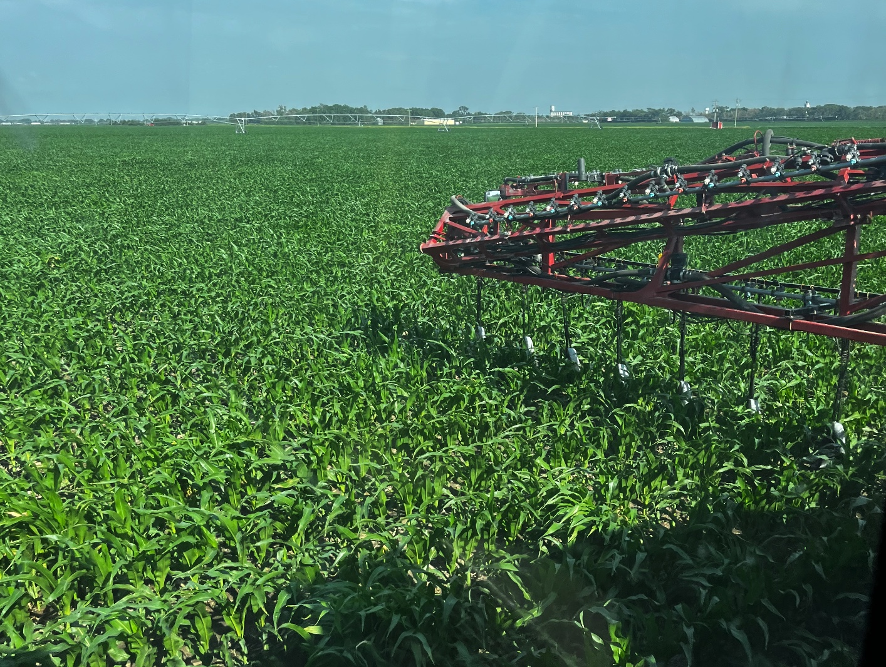
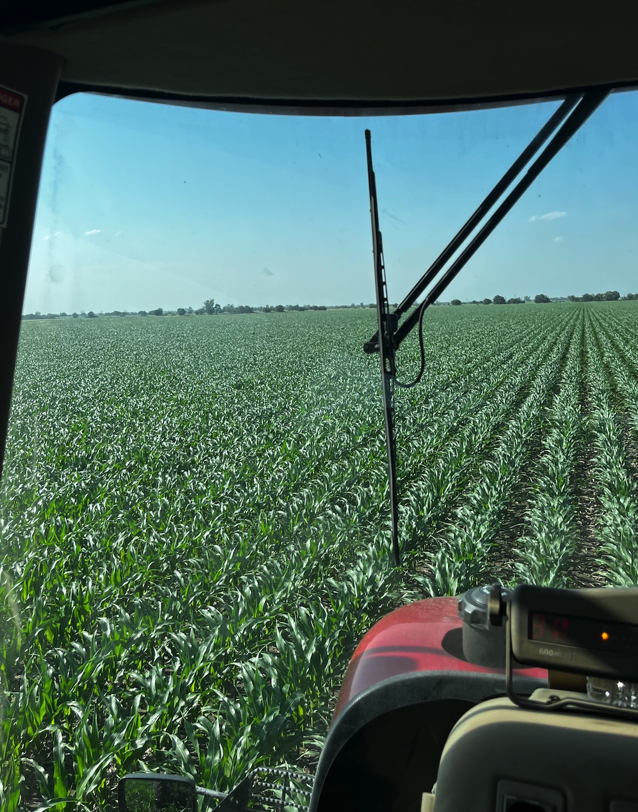

Keith says, "I had soybeans ordered to plant it to beans but then I was running numbers between 250 bushel corn and 85 bushel beans which is a very generous yield when running cash flows I was going to lose money planting the beans. I had one farm I was forced into planting beans for another reason so for this year I decided to go back to corn as much as I wanted to plant beans there. I want to put it back to beans soon it just didn’t make sense financially for this year. "

"I always do like planting some soybeans because the corn always seems a little bit better the next year. I just felt more comfortable with corn if margins are a little tighter and who know I could’ve done the exact wrong thing. I wish I had a market for another crop besides corn and soybeans."

I mentioned that the weather was looking lovely for his upcoming wedding weekend,
and Keith said, "Yes! Not too hot not to cold. I hope we can catch some more rain again. We went from so hot and dry last year to cool and wet this year. I still haven’t sent any pivots around yet."

