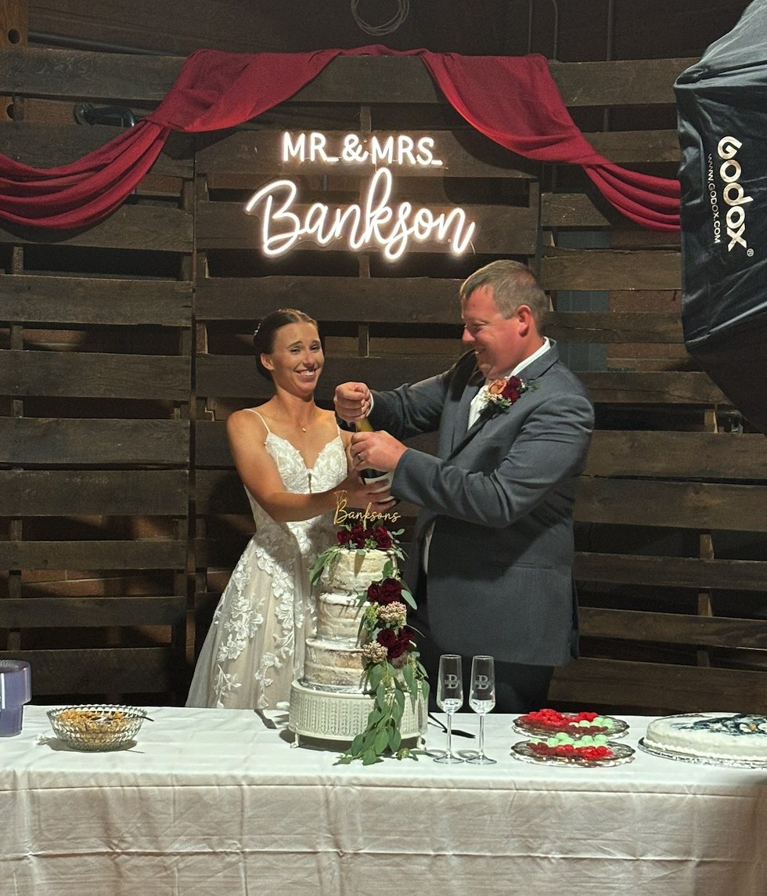
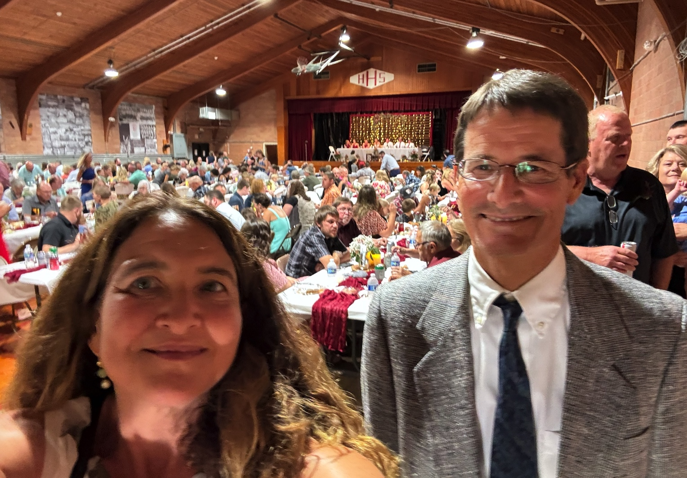
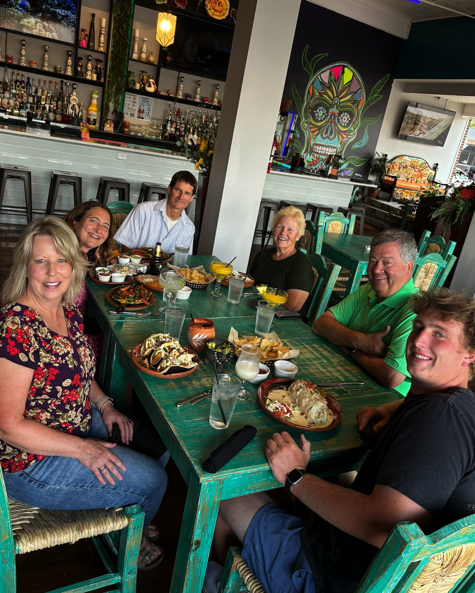

Keith & Breann tie the knot! The minister is young and hip cousin of bride, and delivers a nice custom message. Patti is honored to be among 100 guests in the church. The reception includes just about everyone in Hordville -- about 300 guests! We're last to the buffet, but there are plenty of vegetarian choices left. We get a few dances in, too. 

In other good news, Shelley and I enjoy lovely talks on our walks, and Cliff & Cathy show us their finished 3rd floor apartment -- an extra room if we ever want to stay. Susie treats us to root beer floats at the Stuhr museum as Biden drops out of the race. We donate $$$ to the DNC! Larry rides a mower for the first time, cutting grass im Shelley's front yard. Birthday celebrations at Kiko's with Shelley, Sam, Cathy, and Cliff continue with yummy homemade cake waiting for us at Shelley's house. We end the evening with a walk to the bridge over the Burlington northern tracks, where a empty coal train whips up the wind. 

