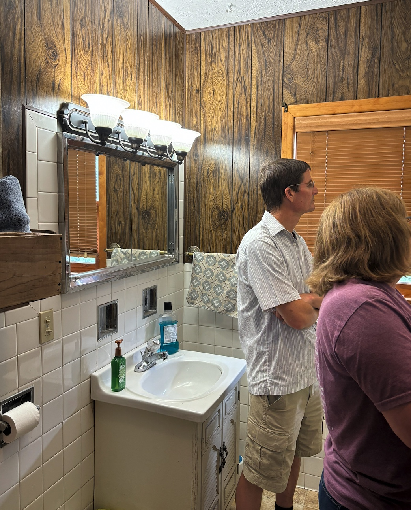
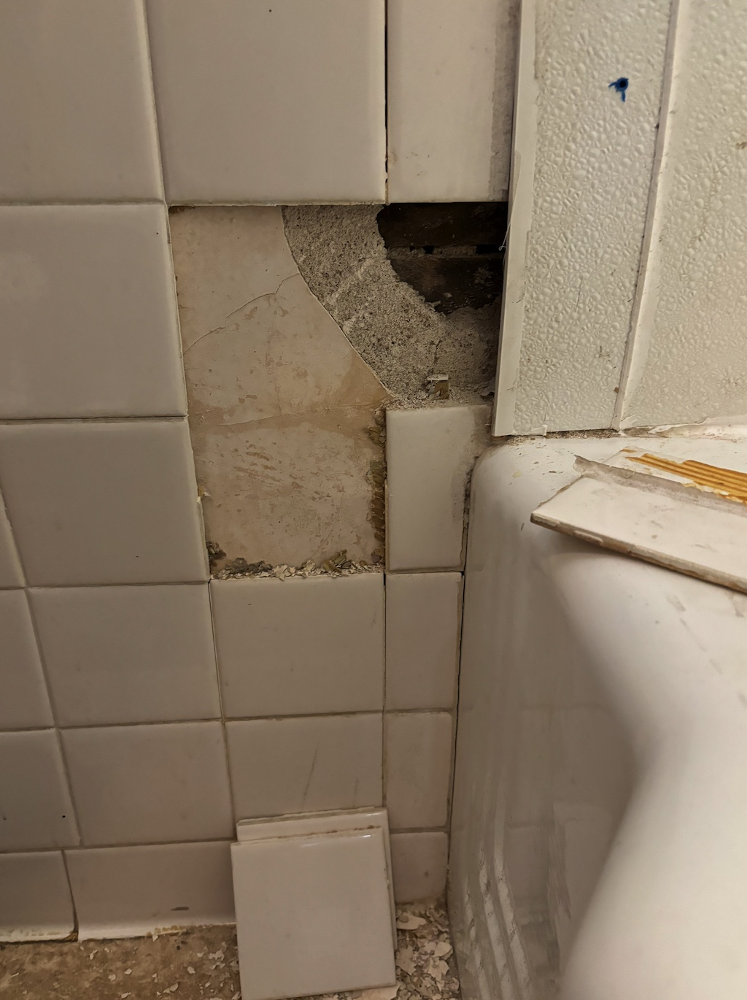
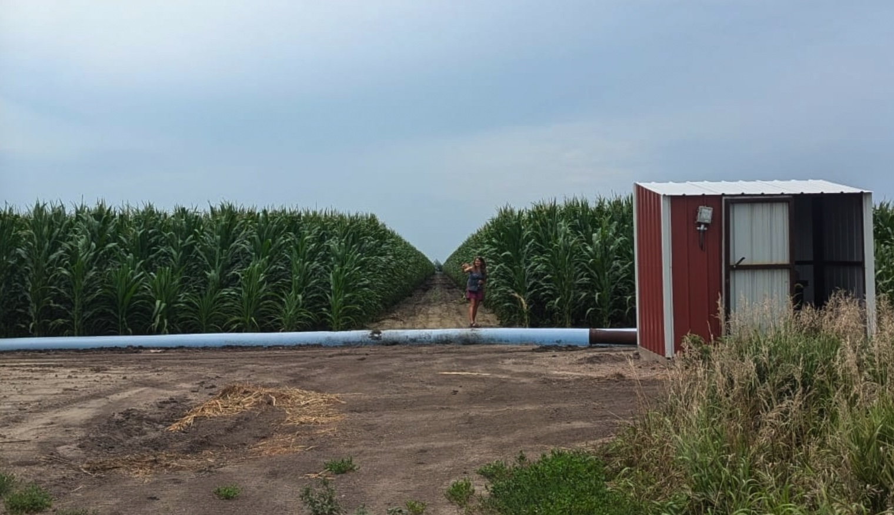

At the farm, the corn is tall and green. But at the house, I'm disappointed about trash in the driveway and weeds around septic tank and barn. We find some clippers and cut down weeds near the septic tank because they can make the walls unstable. Around the house, the relandscaping we did five years ago, with new rocks and plants, has gone to weeds. Both porches need paint and barn windows are broken; things we requested  be fixed a year or two ago. Dad would have loved the corn, but would have had a cow about the house and yard. He took such pride in keeping the outdoors beautiful. 

Marilyn arrives, and walks around the yard with us, showing us where some tree trimming was done. She suggests cutting and removing more trees, dead and alive.  Not sure we want to remove any living trees. 

 In the house, she shows us the bathroom plaster breaking down near the shower, and suggests replacing the shower and redoing all four of the bathroom walls so they match. Then we look at the front door. New front and storm doors were installed in 2017. Marilyn chose  a dark brown door with pretty glass trim, but the dark door baked in the sun. The storm door trapped the heat like an oven, so the trim peeled off. 

Then Marilyn asks if we can pay for a new water softener. I get emotional and begin to  flood. Why should we buy something that isn't required when things we invested thousands in haven't been kept up? She responds well and says she'll work on getting the weeds pulled and trash cleaned up. We agree on fixing door trim, fixing one bathroom wall and shower walls, and hiring someone to paint decks. 

