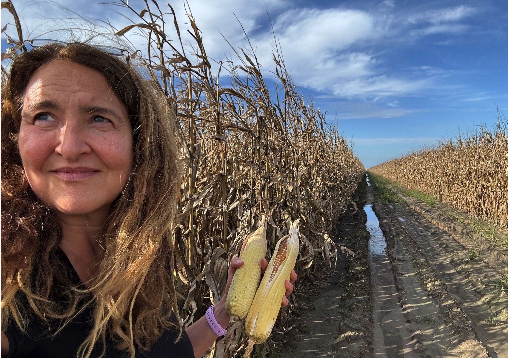
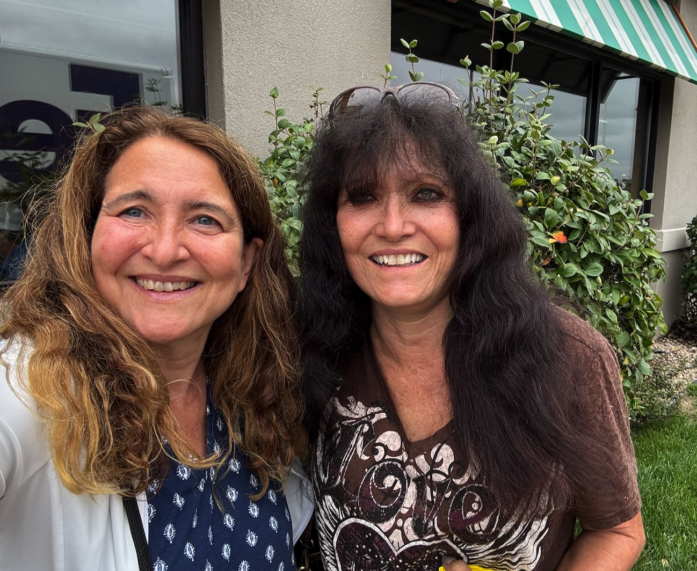
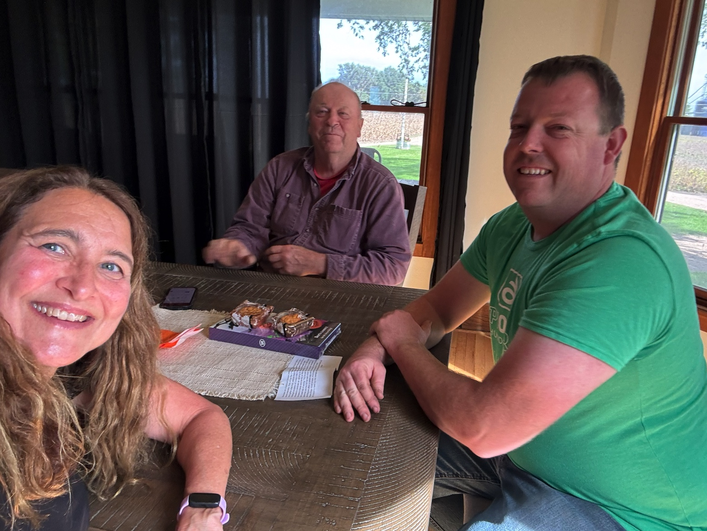
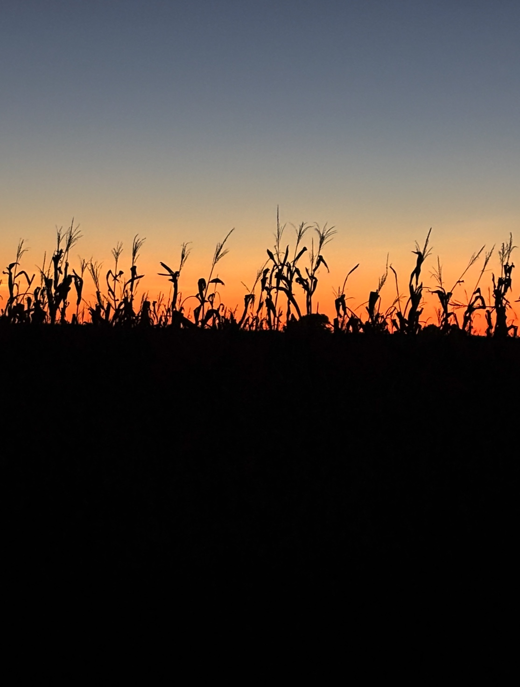

We had some terrible rain the evening I arrived. Some places got 6-10 inches in 24 hours, and there's still flooding in Lincoln. I drove 2.5 hours from the airport to Shelley's house Wednesday night in some of the worst weather I've ever experienced. Couldn't see the road at all on the interstate. Thank goodness I could tuck in behind slow semis and follow their hazard lights for miles. I honestly don't know how I made it!

Corn here should be picked soon -- or picked already -- but they've had so much rain that they haven't been able to start. They hope to pick in a week or two if the rain stops and the ground dries out.

I have a lovely lunch with Susie, great visit with Keith and Larry, and a a blast with Shelley. We play putt put golf! Jeff flies out for our last game in the south stadium, before they demolish and rebuild it. Thanks, dad, for 60+ years of fun seats. 

The evening sky is gorgeous, and corn at sunset becomes a new iPhone wallpaper background :)

